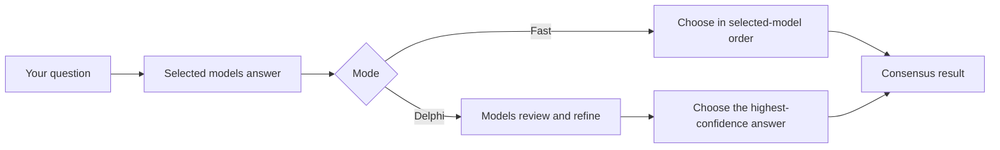

<div align="center">

# 🧠 AI Delphi Technique

### One question. Multiple AI perspectives. A more considered answer.

An AI consensus workspace where four model selections independently answer a question, review one another, and refine their responses—bringing the Delphi method to multi-model AI.

[](./LICENSE)


<br />

<a href="https://res.cloudinary.com/pratikmahara/image/upload/v1781514544/Screenshot_2026-06-15_082226_jctj8o.png">
  
</a>

<br />

[Get started](#-get-started) · [How it works](#-how-it-works) · [API](#-api)

</div>

---

## ✨ Why AI Delphi?

The Delphi method gathers independent expert opinions, shares perspectives, and refines responses toward a stronger conclusion. This project applies that process to AI: compare answers from **GPT, DeepSeek, NVIDIA, and Gemini**, then review the most confident result.

- **Compare perspectives** — choose any combination of the four model options.
- **Refine or move fast** — use Delphi mode for a review round, or Fast mode for initial answers only.
- **Inspect the reasoning trail** — review model responses, confidence, and peer selections.
- **Keep a local history** — successful analyses are saved in your browser.
- **Trace runs with LangSmith** — optional observability for the backend agent workflow.

## 🔄 How it works



In Delphi mode, each selected model produces a response, reviews the other responses, and returns a refined answer with a confidence score. Fast mode skips refinement and selects the first available response in the order you submitted. The app shows the selected answer, model responses, and peer-review summary.

## 🖼️ Screenshots

<details>
<summary>Explore the app</summary>

| Consensus workspace | Model responses | Final answer |
|---|---|---|
|  |  |  |

</details>

## 🧰 Tech stack

| Area | Technology |
|---|---|
| Frontend | React, TypeScript, Tailwind CSS, Vite |
| Primary backend | Node.js, Express |
| Agent workflow | DeepAgents on LangGraph |
| OpenRouter models | GPT, DeepSeek, and NVIDIA selections |
| Google model | Gemini |
| Observability | LangSmith |
| Experimental alternative | Python, FastAPI, and LangGraph |

## 🚀 Get started

### Requirements

- Node.js 20 or later and npm
- An [OpenRouter API key](https://openrouter.ai/) for GPT, DeepSeek, and NVIDIA
- A [Google AI API key](https://aistudio.google.com/) for Gemini
- A [LangSmith API key](https://smith.langchain.com/) if you want tracing

### 1. Configure the backend

From the project root, create a local backend environment file from the example:

```bash
cp .env.example backend/.env
```

Add your provider keys to `backend/.env`:

```dotenv
OPENROUTER_API_KEY=your-openrouter-key
GOOGLE_API_KEY=your-google-ai-key
```

The backend loads this file at startup. Provider keys stay on the server and are not sent to the browser. `backend/.env` is ignored by Git—never commit your real keys.

### 2. Install and start

From the project root:

```bash
npm install
npm run dev
```

The development command starts both the backend and frontend. Open **http://localhost:5173**.

| Service | Default address |
|---|---|
| Frontend | http://localhost:5173 |
| Backend API | http://localhost:5000 |
| Health check | http://localhost:5000/api/health |

The Vite development server proxies `/api` requests to the backend. Set `VITE_API_PROXY_TARGET` in the **root** `.env` file to override the proxy target. The frontend's production API URL is configured with `VITE_API_BASE_URL` (including the `/api` path); server settings such as `PORT` belong in `backend/.env`.

### Deploying on Render

The API allows browser requests from any origin, so no CORS environment variable is required. In the Render **frontend service**, set `VITE_API_BASE_URL` to the backend URL ending in `/api` (for example, `https://langgraph-multiagent-delphitechnique.onrender.com/api`) and redeploy the frontend. This is appropriate only if the API is intended to be publicly accessible to any website.

### Optional: LangSmith tracing

1. In an agent-based LangSmith workspace, create an agent with ID `ai-delphi-technique` and a `production` environment.
2. Set `LANGSMITH_API_KEY` in `backend/.env`.
3. Keep `LANGSMITH_TRACING=true` and `LANGSMITH_ENDPOINT=https://api.smith.langchain.com`, then restart the backend.

The example also includes `LANGSMITH_AGENT_ID` and `LANGSMITH_AGENT_ENVIRONMENT`. No Anthropic API key is required for the current provider setup.

## 🗂️ Project layout

```text
.
├── backend/                  # Primary Node.js / Express API
│   ├── src/
│   │   ├── graph/
│   │   │   ├── graph.js      # Ordered analysis workflow
│   │   │   └── nodes.js      # Model calls, refinement, and selection
│   │   ├── app.js            # API routes and validation
│   │   ├── env.js            # Loads backend/.env
│   │   └── index.js          # HTTP server entry point
│   └── test/                 # Backend tests
├── frontend/
│   └── src/
│       ├── components/       # Reusable UI
│       ├── pages/            # App pages
│       ├── types/            # Shared frontend types
│       └── utils/            # API client and local history
├── server/                   # Experimental Python / FastAPI alternative
├── .env.example              # Environment-variable template
└── package.json              # npm workspaces and root commands
```

The default `npm run dev` command uses the **Node.js backend**. The Python/FastAPI implementation is an experimental alternative and is not launched by the root development command.

## 🔌 API

### `POST /api/analyze`

Analyze a prompt with one or more model selections.

**Request**

```json
{
  "prompt": "What makes a city a good place to live?",
  "mode": "delphi",
  "models": ["GPT", "DeepSeek", "NVIDIA", "Gemini"]
}
```

- `prompt` — required, non-empty string (up to 20,000 characters).
- `mode` — `fast` or `delphi`; defaults to `delphi`.
- `models` — a non-empty selection of `GPT`, `DeepSeek`, `NVIDIA`, and `Gemini`; defaults to all four.

**Response**

```json
{
  "finalAnswer": "The selected model's answer...",
  "bestModel": "Gemini",
  "confidence": 92,
  "explanation": "Selected Gemini's refined response using the model's reported confidence.",
  "refinedAnswers": [
    { "model": "GPT", "answer": "A model response...", "confidence": 78 },
    { "model": "Gemini", "answer": "A refined response...", "confidence": 92 }
  ],
  "peerReviews": [
    {
      "reviewer": "GPT",
      "reviewed": "Gemini",
      "agreement": "agree",
      "comment": "GPT selected Gemini's response as the closest match."
    }
  ],
  "timestamp": "2026-01-01T12:00:00.000Z"
}
```

The response includes the selected answer, per-model answers and confidence, peer-review summaries, an explanation, and a timestamp. Successful analyses are stored in the browser's local history (up to 50 entries).

### `GET /api/health`

Returns API status and whether OpenRouter and Google credentials are configured. It does **not** expose key values.

## 🧪 Development commands

Run these from the project root:

| Command | Description |
|---|---|
| `npm run dev` | Start the backend and frontend |
| `npm run dev:backend` | Start only the Node.js backend |
| `npm run dev:frontend` | Start only the frontend |
| `npm test --workspace backend` | Run backend tests |
| `npm run build` | Build the frontend for production |
| `npm run lint` | Lint the frontend |
| `npm run typecheck` | Type-check the frontend |

## 📈 LangSmith

When enabled, LangSmith helps inspect agent runs and diagnose model or workflow behavior.


## 📄 License

Distributed under the MIT License. See [`LICENSE`](./LICENSE) for details.

---

<div align="center">

Made for curious questions and better-informed answers.

</div>
